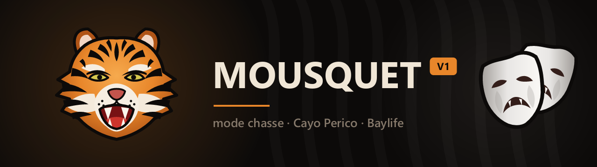
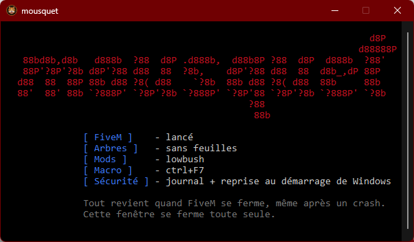

<p align="center">
  
</p>

<p align="center">
  
  
  
  
  <a href="../../actions/workflows/release.yml"></a>
  <a href="LICENSE"></a>
</p>

**mousquet** prépare FiveM pour la chasse à Cayo Perico sur **Baylife**, en un double-clic. Ton pack graphique et tes
mods restent ; le temps du jeu, mousquet ajoute les **arbres sans feuilles**, les mods de `mods_chasse` (lowbush) et
la **macro peaux**. Quand tu fermes FiveM, tout est retiré : ton FiveM redevient exactement ce qu'il était.

Un seul fichier, `mousquet.exe`, écrit en Rust : rien à installer, aucune question.

> [!WARNING]
> Les arbres sans feuilles, lowbush et la macro donnent un avantage et sont interdits sur beaucoup de serveurs :
> **ban possible**. mousquet ne fournit aucun mod. Tu les utilises à tes risques.

> [!NOTE]
> mousquet ne lit jamais la mémoire du jeu et n'y injecte rien. Jeu fermé, il pose quelques fichiers de données
> dans le dossier de FiveM. Jeu ouvert, il lit l'écran et appuie sur les touches seulement quand tu fais Ctrl+F7.

## 🚀 Démarrer

1. Récupère `mousquet.exe` :
   - **tout prêt** : dans la [dernière version](../../releases/latest) (compilé par GitHub depuis ce code, avec son
     empreinte SHA-256) ;
   - **ou compilé chez toi** : télécharge le code (**Code** → **Download ZIP**), puis double-clique sur
     `compiler.bat` (voir *Compiler soi-même* plus bas).

   Mets-le dans un dossier à toi (par exemple `Bureau\mousquet`), avec tes mods de chasse (`.rpf`) dans le dossier
   `mods_chasse` à côté.
2. **Ferme FiveM**, puis double-clique sur `mousquet.exe`. Au premier lancement, Windows peut afficher « Windows a
   protégé votre ordinateur » : **Informations complémentaires** → **Exécuter quand même** (l'exe n'est pas signé).

Une petite console s'ouvre, montre l'état, puis se ferme toute seule :

<p align="center">
  
</p>

Ensuite, un programme sans fenêtre reste en fond : il garde la macro, relance FiveM s'il s'arrête pendant son
démarrage (mise à jour, changement de version) et, quand tu fermes FiveM, retire tout au bout de 10 secondes puis
s'arrête. Rien à fermer de ton côté.

Si FiveM est déjà ouvert quand tu lances mousquet, la macro marche tout de suite et les arbres seront là au
prochain lancement de FiveM (le jeu lit ces fichiers à son démarrage).

> [!TIP]
> `mousquet.exe --apercu` ouvre seulement la console avec un état d'exemple : rien n'est posé ni lancé.

## 🌳 Arbres sans feuilles

Ce sont les 20 réglages de shaders des arbres (`citizen\common\shaders\db\trees*.sps`), vidés comme dans le pack
Skyline : les feuillages ne sont plus dessinés, tu vois à travers. Ton pack normal n'est pas modifié : ces fichiers
sont posés à côté le temps du jeu, puis retirés.

## 🦌 Macro peaux

Après une bête, **Ctrl + F7** fait à ta place :

1. **F2** → Déposer → chaque **peau de bête exotique**, rare ou non, au maximum dans ton sac ;
2. **F5** → Inventaire → chaque **venaison exotique** → Supprimer → Oui.

Si le sac est plein, le reste reste dans ton inventaire.

**Comment elle tient la route.** Les menus de Baylife sont des menus RageUI : après chaque appui, RageUI ignore la
même touche pendant **175 ms**. L'ancienne macro tapait toutes les 130 ms, donc une flèche sur deux était perdue et
elle s'arrêtait sur « curseur pas sur la bonne ligne ». Maintenant :

- **le bon rythme** : deux appuis de la même touche sont espacés de 215 ms ; deux touches différentes s'enchaînent
  sans attendre ;
- **chaque appui est vu** : la barre blanche de la ligne choisie est repérée aux pixels en moins d'une
  milliseconde ; si elle n'a ni bougé ni changé de texte, la touche est refaite ;
- **l'OCR seulement pour décider** : l'OCR de Windows lit toute la liste quand il faut y chercher une ligne, sinon
  seulement le haut du menu jusqu'à la ligne choisie ; une lecture déjà faite n'est jamais refaite ;
- **le plus court chemin** : les menus gardent la position du curseur, et RageUI passe de la dernière ligne à la
  première : la macro prend le bout le plus proche ;
- **jamais une Entrée à l'aveugle** : la ligne est relue deux fois avant chaque Entrée (« Supprimer », puis « Oui »
  sur la venaison seulement). Un menu inattendu, ou FiveM qui passe derrière, l'arrête net.

Chaque résultat est noté dans `mousquet.log` avec sa durée. Un arrêt y est noté avec ses derniers pas (touches
✓ vues, ✗ refaites, et ce qui a été lu) et l'image de ce moment-là (`reglages\macro_erreurs`).

## 🛟 Crash, coupure, PC qui s'éteint

Ton citizen et tes mods ne restent jamais abîmés :

- avant de toucher à quoi que ce soit, mousquet écrit sur le disque un **journal** de tout ce qu'il va poser, de ce
  qui existait déjà et des dossiers qu'il va créer ;
- un fichier à toi n'est **jamais écrasé** : s'il porte le même nom, il est mis de côté dans
  `FiveM\mis_de_cote_par_mousquet`, puis remis ;
- chaque fichier est écrit à côté puis mis en place d'un coup : jamais de fichier à moitié écrit ;
- au retrait, un fichier n'est effacé que s'il est **exactement** celui que mousquet a posé ; s'il a changé, il est
  gardé dans `mis_de_cote_par_mousquet\conflits` ;
- le temps du jeu, une ligne `mousquet_reprise` est ajoutée au démarrage de Windows : si le PC s'éteint d'un coup,
  mousquet se relance tout seul au démarrage suivant, sans fenêtre, attend que FiveM soit fermé et remet tout, puis
  retire cette ligne. En temps normal, elle est retirée dès la fin du jeu ;
- relancer `mousquet.exe` remet aussi d'abord tout ce qui serait resté, avant de reposer quoi que ce soit.

Tout ce que fait mousquet est noté dans `mousquet.log`.

## 📁 Fichiers

| Fichier | Rôle |
|---|---|
| `mousquet.exe` | tout le programme |
| `compiler.bat` | compile `mousquet.exe` depuis le code (Rust) |
| `mods_chasse\` | tes mods de chasse (`.rpf` seulement, jamais de `.dll` ni de `.asi`) |
| `reglages\macro_erreurs\` | les images lues quand la macro s'est arrêtée |
| `mousquet.log` | le journal |

## 🛠️ Compiler soi-même

**Le plus simple** : installe [Rust](https://rustup.rs) (`rustup-init.exe`, choix par défaut ; il propose aussi les
outils de build C++ de Visual Studio s'ils manquent), puis double-clique sur **`compiler.bat`**. Il compile et pose
`mousquet.exe` à côté de lui. La première compilation prend quelques minutes.

**En ligne de commande** :

```powershell
winget install Rustlang.Rustup
cargo build --release
```

L'exe est dans `target\release\mousquet.exe`. `cargo test` lance les essais : pose et retrait à l'identique, une
coupure de courant simulée à chaque instant de la pose, fichiers changés pendant le jeu, relances de FiveM, la barre
du menu repérée aux pixels, et la macro sur un faux jeu RageUI (verrou de 175 ms par touche, curseurs gardés, listes
qui défilent, sac plein, 25 venaisons, 200 cas tirés au sort avec OCR bruité et touches perdues).

**Sur GitHub** : chaque push est compilé et testé par [GitHub Actions](.github/workflows/release.yml) (l'exe est
gardé comme artefact). Pour publier une version :

```powershell
git tag v1.1.0
git push origin v1.1.0
```

La Release est créée toute seule, avec `mousquet.exe` et `mousquet.exe.sha256`.

## 📜 Licence

mousquet n'est pas un logiciel libre : tu peux l'installer et l'utiliser gratuitement, mais pas le modifier ni le
redistribuer. Voir [LICENSE](LICENSE).

<sub>Projet indépendant, sans lien avec l'équipe de Baylife ni avec Cfx.re.</sub>
