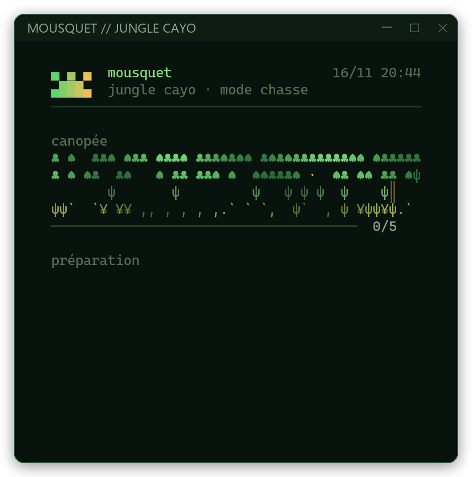
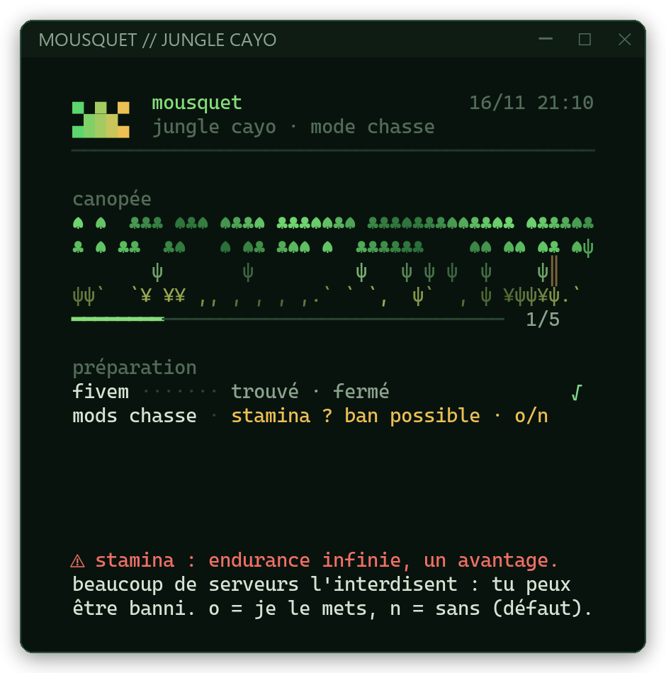
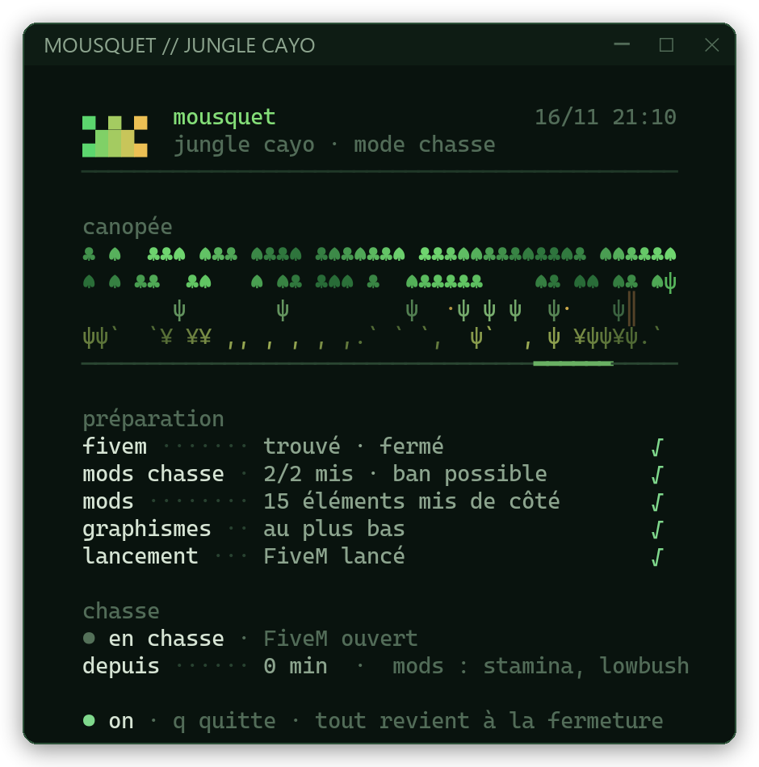
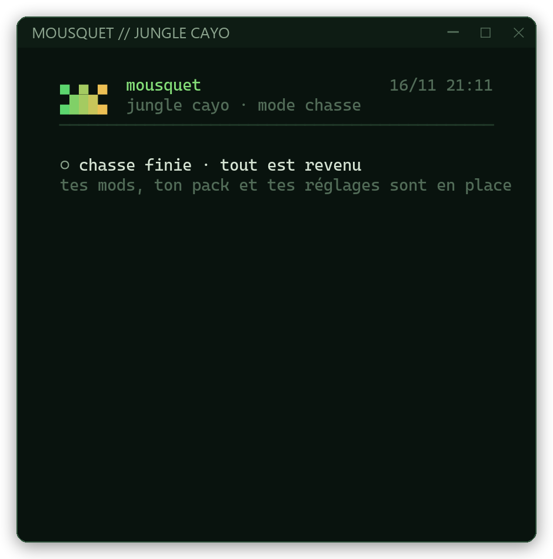

  

  
  
  
  
  

**mousquet** prépare FiveM pour la chasse à Cayo Perico sur **Baylife**. Le temps de la chasse, ton FiveM tourne
« tout neuf » : sans tes mods, sans ton pack graphique, avec les graphismes au plus bas. Quand tu fermes FiveM, tout
revient exactement à sa place.

  

> [!NOTE]
> mousquet ne touche ni au jeu ni à sa mémoire, et n'appuie sur aucune touche. Jeu fermé, il déplace des fichiers
> dans le dossier de FiveM et change tes réglages graphiques. C'est tout.

> [!WARNING]
> Les mods de chasse comme **lowbush** (moins de buissons) ou **stamina** (endurance infinie) donnent un avantage
> et sont interdits sur beaucoup de serveurs : **ban possible**. mousquet ne fournit aucun mod. Si tu en mets, il te
> les demande un par un à chaque chasse, avec cet avertissement.

## 🚀 Démarrer

1. Installe [Python 3.12 ou plus](https://www.python.org/downloads/) (coche « Add python.exe to PATH »).
   mousquet n'a besoin d'aucune autre bibliothèque.
2. Télécharge le dépôt : bouton **Code** → **Download ZIP**, puis décompresse-le où tu veux.
3. **Ferme FiveM**, puis double-clique sur `mousquet.bat`.

mousquet prépare tout, lance FiveM, puis attend. Tu joues normalement. Quand tu fermes FiveM, il remet tout en place
au bout de 10 secondes, affiche « chasse finie · tout est revenu » et se ferme tout seul.

## 🌿 Ce qu'il fait

<table>
  <tr>
    <td align="center"> <b>Avant</b> : chaque mod demandé, avec l'avertissement</td>
    <td align="center"> <b>Pendant</b> : FiveM tourne tout neuf</td>
    <td align="center"> <b>Après</b> : tout est revenu</td>
  </tr>
</table>

| Étape | Ce qui se passe |
|---|---|
| **fivem** | vérifie que FiveM est installé et fermé (ouvert, il refuse : les fichiers seraient verrouillés) |
| **mods chasse** | pour chaque mod de `mods_chasse`, te demande `o` ou `n` (sans réponse en 20 s : non) |
| **mods** | déplace tout ce qui est dans `FiveM.app\mods` et `FiveM.app\plugins` (mods, ReShade, presets…) vers `FiveM\mis_de_cote_par_mousquet`, puis copie tes mods de chasse |
| **graphismes** | garde tes réglages dans `reglages\normal.xml` et met les plus bas du jeu (résolution, plein écran et densité de population ne bougent pas) |
| **lancement** | ouvre FiveM |

Les fichiers sont **déplacés**, pas copiés : c'est instantané et ça ne prend aucune place en plus. Une liste de chaque
élément est écrite **avant** chaque déplacement : même après une panne de courant, tout peut revenir.

Si tu changes des réglages graphiques pendant la chasse, ils sont gardés dans `reglages\chasse.xml` pour la
prochaine fois.

## 🎯 Mods de chasse

Mets les `.rpf` que tu veux pendant la chasse dans le dossier `mods_chasse`. À chaque chasse, mousquet te les
propose un par un : rien n'est mis sans un `o`. Ceux que tu acceptes vont dans FiveM le temps de la chasse, puis en
ressortent. Seuls les `.rpf` sont pris : jamais de `.dll` ni de `.asi`, qui sont des programmes.

mousquet reconnaît **lowbush** (moins de buissons) et **stamina** (endurance infinie) et te dit ce qu'ils changent.
Un mod qu'il ne connaît pas est proposé quand même, avec le même avertissement.

## 🛟 Si tu fermes mousquet avant FiveM

- **q**, **une relance** de `mousquet.bat` ou **la croix** de la fenêtre : mousquet se ferme et laisse un gardien
  discret, sans fenêtre. Il remet tout dès que FiveM se ferme.
- **FiveM ne s'ouvre jamais** (90 s) : tout est remis.
- **Panne** (PC éteint en pleine chasse) : relance `mousquet.bat`. Il remet d'abord tout ce qui est resté de côté.
- Si un fichier a été recréé par FiveM pendant la chasse à la place d'un des tiens, rien n'est écrasé : le nouveau
  est gardé dans `FiveM\mis_de_cote_par_mousquet\conflits`.

Tout ce que fait mousquet est noté dans `mousquet.log`.

## 📁 Fichiers

| Fichier | Rôle |
|---|---|
| `mousquet.bat` | lance mousquet dans sa console |
| `mousquet.py` | tout le programme (bibliothèque standard de Python seulement) |
| `mods_chasse\` | tes mods de chasse (`.rpf`) |
| `reglages\` | créé au premier lancement : tes réglages normaux et ceux de chasse |
| `mousquet.log` | créé au premier lancement : le journal |

## 📜 Licence

mousquet n'est pas un logiciel libre : tu peux l'installer et l'utiliser gratuitement, mais pas le modifier ni le
redistribuer. Voir [LICENSE](LICENSE).

Projet indépendant, sans lien avec l'équipe de Baylife ni avec Cfx.re.
